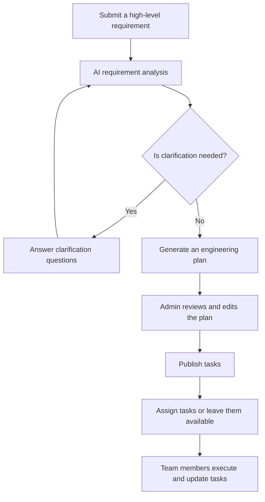
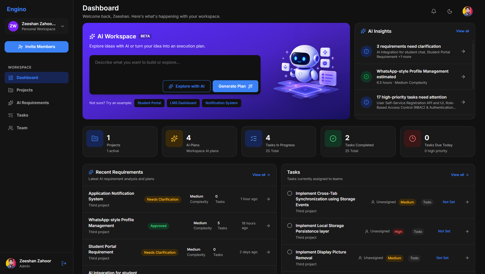
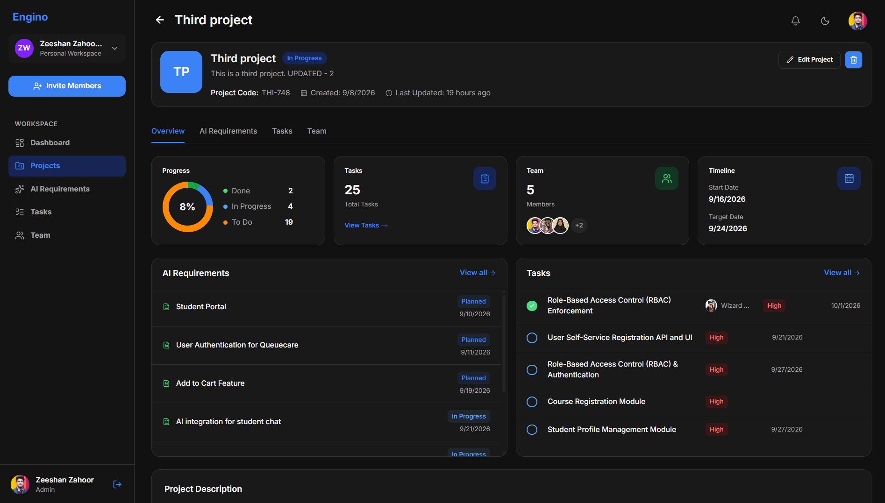
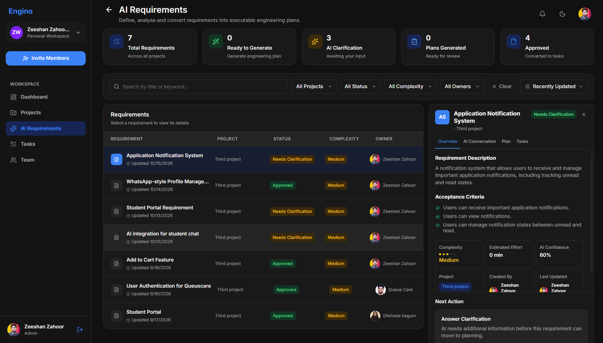
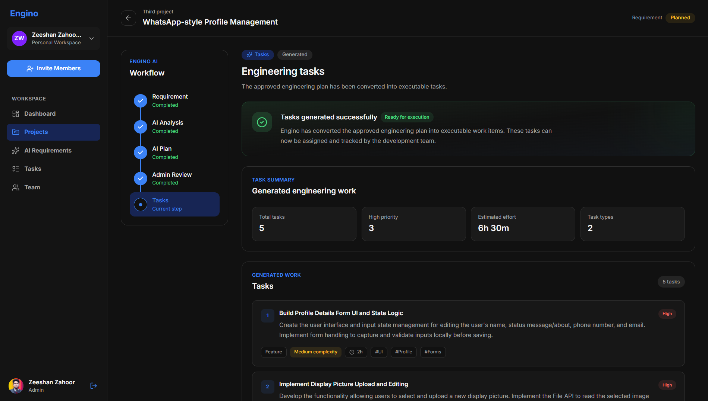
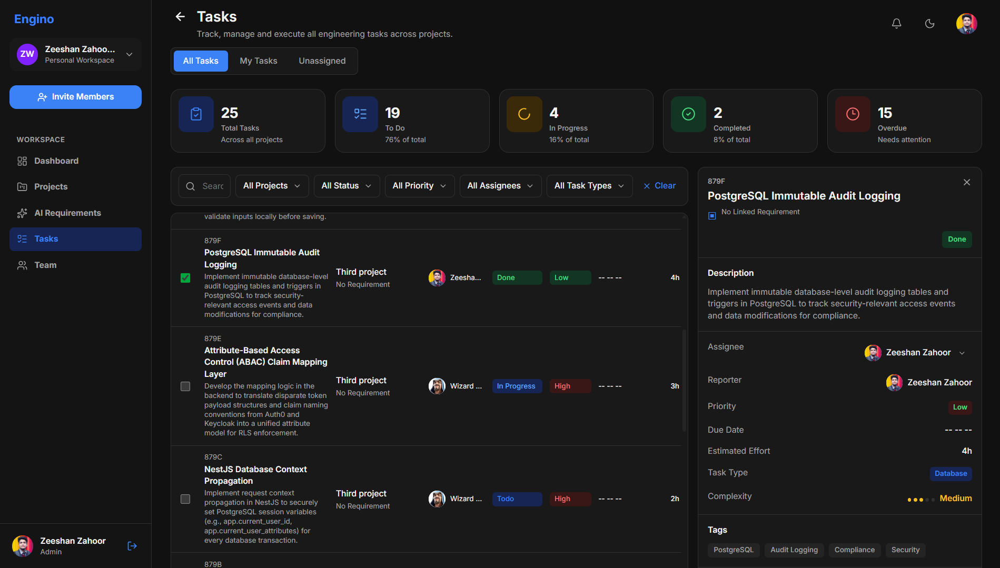
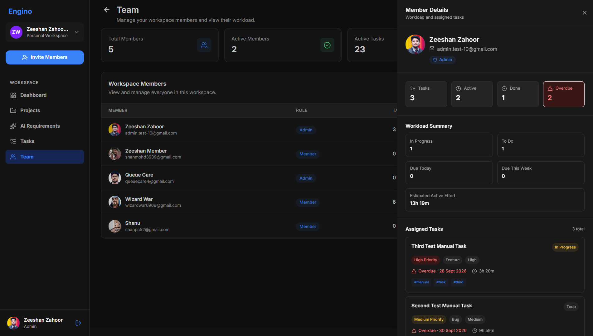
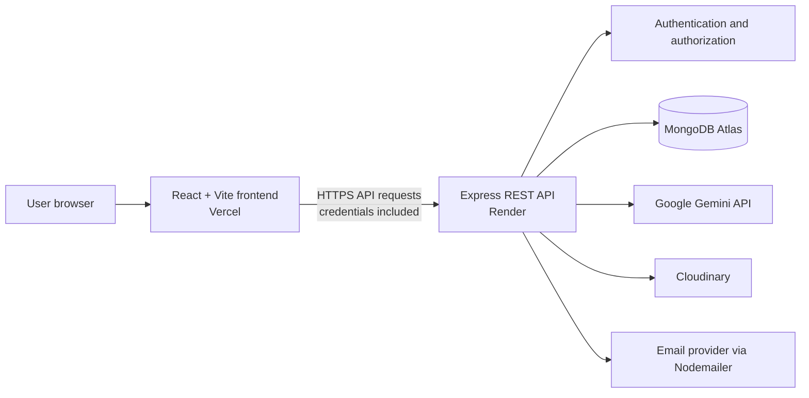

<div align="center">
    
# Engino

### Turn ambiguous product requirements into executable engineering work.

An AI-powered engineering execution platform that helps teams move from
vague ideas to structured plans, reviewed tasks, and coordinated
execution.

[](https://engino.vercel.app)
[](https://react.dev/)
[](https://expressjs.com/)
[](https://www.mongodb.com/)

[Live Application](https://engino.vercel.app) · [GitHub
Repository](https://github.com/zeeshan-zahoor/engino)
</div>

------------------------------------------------------------------------

## The problem

A request like *"Build a student portal"* may sound clear to the person
asking for it. For the developer receiving it, important questions
remain:

-   What features and deliverables are expected?
-   Which frontend, backend, and database tasks are required?
-   What details are still ambiguous?
-   In what order should the work be completed?
-   What does a successful result look like?

Traditional project-management tools help teams organize work once the
work is understood. Engino focuses on the step before that: **turning
high-level requirements into clearer, reviewable engineering work.**

## What is Engino?

Engino is an AI-powered engineering execution platform built around a
guided requirement-to-task workflow. It combines AI-assisted requirement
analysis and planning with workspace collaboration, task management, and
team coordination.

Rather than treating AI as a standalone chat window, Engino embeds AI
into a practical engineering workflow. People remain in control:
generated plans can be reviewed before tasks are published for
execution.

> **Core idea:** Reduce ambiguity before implementation begins.

## How it works



1.  **Describe the requirement.** Start with a high-level product or
    feature request.
2.  **Analyze ambiguity.** Engino uses Gemini to analyze the requirement
    and identify information that may need clarification.
3.  **Clarify when needed.** Answer follow-up questions before
    proceeding with an unclear requirement.
4.  **Generate a plan.** Turn the requirement into a structured
    engineering plan.
5.  **Review before publishing.** An administrator can review and adjust
    generated output before creating execution work.
6.  **Coordinate execution.** Manage tasks, assignments, task claiming,
    due dates, and status updates within the workspace.

AI output is a starting point for review, not a guarantee of
correctness. Teams should validate generated plans before acting on
them.

## Features in V1

### AI-assisted requirement workflow

-   Submit high-level engineering requirements.
-   Analyze requirements using Google's Gemini API.
-   Identify ambiguity and request clarification where needed.
-   Generate structured plans for engineering work.
-   Review and edit AI-generated output before tasks are published.

### Workspace and team collaboration

-   Create and manage workspaces.
-   Invite team members.
-   Support workspace-level **Admin** and **Member** roles.
-   View team members and their assigned workload.
-   Allow administrators to change member roles and remove members,
    subject to application safeguards.

### Task management

-   Create tasks from reviewed engineering plans.
-   Assign tasks to team members or leave tasks available to claim.
-   Let eligible members claim unassigned tasks.
-   Track task status, due dates, and estimated effort where provided.
-   View and manage tasks from the task interface.

### Dashboard and project organization

-   Dashboard summaries and project progress views.
-   Project and requirement navigation.
-   Requirement details and workflow progress.
-   Task and team views connected to the wider workspace.

### Notifications

-   Notifications for task-assignment events.
-   Unread notification count.
-   Mark individual notifications as read or mark all as read.
-   Navigate from a notification to the associated task.

### Account management

-   View and update profile information.
-   Upload or remove an avatar.
-   Change account password.

### Responsive interface and themes

-   Responsive layouts for desktop and mobile screens.
-   Mobile navigation and viewport-aware modal layouts.
-   Light and dark theme support.

> **V1 scope:** Engino focuses on requirement analysis, planning,
> review, and task execution. Repository-aware AI, automated GitHub
> issue creation, pull-request tracking, and code review are not shipped
> V1 capabilities.

## Screenshots

The following screenshots show the main product workflows and interface:

### Dashboard



### Projects



### Requirements and AI analysis





### Tasks



### Team management



## Technology stack

  -----------------------------------------------------------------------
  Layer                               Technology
  ----------------------------------- -----------------------------------
  Frontend                            React, Vite, JavaScript

  UI styling                          Tailwind CSS

  Client-side state                   Zustand

  HTTP client                         Axios

  Backend runtime                     Node.js

  API framework                       Express

  Database                            MongoDB with Mongoose

  Authentication                      JSON Web Tokens (JWT), bcryptjs
                                      password hashing, HTTP-only cookies

  AI integration                      Google Gemini via `@google/genai`

  Image/avatar storage                Cloudinary

  Email                               Nodemailer

  Frontend hosting                    Vercel

  Backend hosting                     Render

  Database hosting                    MongoDB Atlas
  -----------------------------------------------------------------------

## Architecture

Engino uses a separately deployed frontend and backend. The browser
loads the React application from Vercel and calls the Express API hosted
on Render. The backend connects to MongoDB Atlas and uses server-side
integrations for AI, image storage, and email.



### Architectural notes

-   **Separate deployments:** Frontend and backend are hosted
    independently.
-   **Server-side secrets:** Gemini, database, JWT, and Cloudinary
    credentials belong in backend environment configuration, not
    client-side variables.
-   **Cookie authentication:** The Axios client uses
    `withCredentials: true`; the backend must allow the exact frontend
    origin with credentialed CORS and configure cookies appropriately
    for production.
-   **API-mediated data access:** The browser should call application
    endpoints rather than connect directly to MongoDB.
-   **SPA routing:** Vercel needs an appropriate rewrite configuration
    so direct navigation and refreshes on React Router routes serve the
    frontend entry point.

## Repository layout

The repository has separate frontend and backend areas. This is a
conceptual overview; verify exact filenames against the current source.

``` text
engino/
├── client/                  # React + Vite frontend
│   ├── src/
│   │   ├── components/      # Shared UI components
│   │   ├── pages/           # Application pages
│   │   ├── routes/          # Client-side routes
│   │   ├── stores/          # Zustand stores
│   │   └── ...
│   └── package.json
├── server/                  # Express API
│   ├── src/
│   │   ├── config/          # Configuration and database setup
│   │   ├── controllers/     # Request handlers
│   │   ├── routers/         # API routes
│   │   └── server.js        # Server entry point
│   └── package.json
└── README.md
```

## Getting started locally

### Prerequisites

-   Node.js and npm
-   A MongoDB connection string (local MongoDB or MongoDB Atlas)
-   A Google Gemini API key for AI features
-   Cloudinary credentials for avatar uploads
-   Email-provider credentials if using email-based functionality

### 1. Clone the repository

``` bash
git clone https://github.com/zeeshan-zahoor/engino.git
cd engino
```

### 2. Configure the backend

``` bash
cd server
npm install
```

Create `server/.env`:

``` env
PORT=5000
MONGODB_URI=your_mongodb_connection_string

GEMINI_API_KEY=your_gemini_api_key

JWT_SECRET=replace_with_a_strong_random_secret
JWT_EXPIRY=your_configured_jwt_expiry_value

EMAIL_USER=your_email_username
EMAIL_PASSWORD=your_email_or_smtp_password

FRONTEND_URL=http://localhost:5173

CLOUDINARY_CLOUD_NAME=your_cloudinary_cloud_name
CLOUDINARY_API_KEY=your_cloudinary_api_key
CLOUDINARY_API_SECRET=your_cloudinary_api_secret
```

Replace all example values with your own credentials. Never commit
`.env` files or share their contents.

Run the backend:

``` bash
npm run dev
```

The backend package also defines `npm start` for running the server
without Nodemon.

### 3. Configure the frontend

Open a second terminal:

``` bash
cd client
npm install
```

Create `client/.env`:

``` env
VITE_API_URL=http://localhost:5000/api
```

Run the frontend:

``` bash
npm run dev
```

Vite normally serves the development app at `http://localhost:5173`.

### 4. Open Engino

Visit <http://localhost:5173>. Ensure the backend is running, the
database is reachable, and your environment variables are valid. AI
generation, email, and avatar uploads also require their respective
provider credentials.

## Environment variables

### Frontend

  -----------------------------------------------------------------------------
  Variable                Purpose                 Example
  ----------------------- ----------------------- -----------------------------
  `VITE_API_URL`          Base URL for the        `http://localhost:5000/api`
                          backend API             

  -----------------------------------------------------------------------------

Vite exposes variables prefixed with `VITE_` to client-side code.
**Never put API keys, database credentials, JWT secrets, or other
private values in `VITE_` variables.**

### Backend

  Variable                  Purpose
  ------------------------- -------------------------------------
  `PORT`                    Port used by the Express server
  `MONGODB_URI`             MongoDB connection URI
  `GEMINI_API_KEY`          Gemini API authentication
  `JWT_SECRET`              Secret used to sign or verify JWTs
  `JWT_EXPIRY`              Token expiry configuration
  `EMAIL_USER`              Email account or SMTP username
  `EMAIL_PASSWORD`          Email or SMTP password
  `FRONTEND_URL`            Frontend origin permitted by CORS
  `CLOUDINARY_CLOUD_NAME`   Cloudinary account/cloud identifier
  `CLOUDINARY_API_KEY`      Cloudinary API key
  `CLOUDINARY_API_SECRET`   Cloudinary API secret

The exact accepted formats for `JWT_EXPIRY` and email settings depend on
the implementation and provider configuration. Use the values expected
by the backend.

## Deployment

Engino V1 is deployed with Vercel, Render, and MongoDB Atlas.

### Frontend --- Vercel

1.  Import the GitHub repository into Vercel and set the project root to
    `client` if that matches your project configuration.

2.  For a standard Vite application, the build command is typically
    `npm run build` and the output directory is `dist`.

3.  Add this production environment variable:

    ``` env
    VITE_API_URL=https://engino.onrender.com/api
    ```

4.  Redeploy after changing environment variables because Vite reads
    them during the build.

5.  Ensure direct navigation and refreshes on nested React Router routes
    work with the Vercel SPA rewrite configuration.

Live application: **[engino.vercel.app](https://engino.vercel.app)**

### Backend --- Render

1.  Create a Render Web Service connected to the repository.
2.  Set the root directory to `server`.
3.  Use `npm install` as the build command and `npm start` as the start
    command.
4.  Configure backend environment variables in Render.
5.  Let the hosting environment provide `PORT` unless the deployment
    setup requires otherwise.
6.  Set `FRONTEND_URL` to the exact production frontend origin:
    `https://engino.vercel.app` (no `/api` suffix).
7.  Check service logs and verify the root endpoint reports that the API
    is running.

### Database --- MongoDB Atlas

1.  Create a database deployment and database user.
2.  Configure network access for the backend's connectivity
    requirements.
3.  Set `MONGODB_URI` in Render.
4.  Use least-privilege database credentials and avoid exposing the URI
    in logs or source control.

### Production checklist

-   [*] Secrets are configured in hosting environment settings.
-   [*] `VITE_API_URL` points to the deployed API.
-   [*] Backend CORS allows the exact production frontend origin with
    credentials enabled.
-   [*] Authentication cookies use compatible production attributes.
-   [*] MongoDB Atlas accepts connections from the backend.
-   [*] Nested frontend routes work on direct navigation and refresh.
-   [*] Login, logout, workspace access, AI workflow, tasks,
    notifications, and uploads have been tested in production.
-   [*] No credentials or tokens appear in screenshots, logs, or
    repository history.

## API overview

The Express backend groups functionality under these `/api` prefixes:

  -----------------------------------------------------------------------------------------------------------------------
  Prefix                                                                              Responsibility
  ----------------------------------------------------------------------------------- -----------------------------------
  `/api/auth`                                                                         Authentication and account-related
                                                                                      endpoints

  `/api/workspaces`                                                                   Workspace and team operations

  `/api/workspaces/:workspaceId/projects`                                             Project operations

  `/api/workspaces/:workspaceId/projects/:projectId/requirements`                     Requirement operations

  `/api/workspaces/:workspaceId/projects/:projectId/requirements/:requirementId`      Requirement plan operations

  `/api/workspaces/:workspaceId/projects/:projectId/requirements/:requirementId/ai`   AI operations for a requirement

  `/api/workspaces/:workspaceId/projects/:projectId/tasks`                            Project task operations

  `/api/notifications`                                                                User notifications
  -----------------------------------------------------------------------------------------------------------------------

This is a route-group overview, not a complete endpoint specification.
Consult the backend routers for exact methods, parameters, validation,
and authorization rules.

## Security considerations

-   Keep private API keys and database credentials on the backend.
-   Use strong, unique production secrets and rotate credentials if they
    are exposed.
-   Keep dependencies updated and review security advisories.
-   Restrict database access and use least-privilege database
    credentials.
-   Configure CORS for the expected frontend origin rather than allowing
    arbitrary origins with credentials.
-   Use HTTPS and secure cookie settings appropriate to the deployed
    frontend/backend topology.
-   Avoid logging authentication tokens, passwords, or API keys.
-   Treat AI-generated plans as suggestions that require human review.

This is implementation guidance, not a claim of an independent security
audit or certification.

## Roadmap

The following are future directions, **not shipped V1 features**.

### V2 --- Repository understanding

Explore connecting a code repository so Engino can use project context
to improve planning. Potential capabilities: - Analyze repository
structure and technology choices. - Identify relevant existing
components, APIs, and data models. - Suggest relevant files and modules
to inspect. - Generate more repository-aware implementation suggestions.

### Longer-term possibilities

Depending on validation and priorities: - GitHub issue creation and
synchronization. - Pull-request and branch status tracking. -
AI-assisted developer onboarding and architecture explanations. - More
context-aware recommendations about task order and potential blockers.

These ideas are exploratory and do not imply that integrations or
automated workflows already exist.

## Contributing

Engino is an evolving project. To suggest an improvement or report an
issue:

1.  Check existing issues to avoid duplicates.
2.  Open an issue describing the problem, expected behavior, and
    reproduction steps.
3.  For code changes, create a focused branch and submit a pull request
    with a clear explanation and relevant testing details.

For substantial changes, discuss the proposal before investing in a
large implementation.

## Author

**Zeeshan Zahoor**

-   GitHub: [@zeeshan-zahoor](https://github.com/zeeshan-zahoor)
-   Repository:
    [zeeshan-zahoor/engino](https://github.com/zeeshan-zahoor/engino)
-   Live application: [engino.vercel.app](https://engino.vercel.app)

## License

This project is licensed under the [MIT License](LICENSE).
